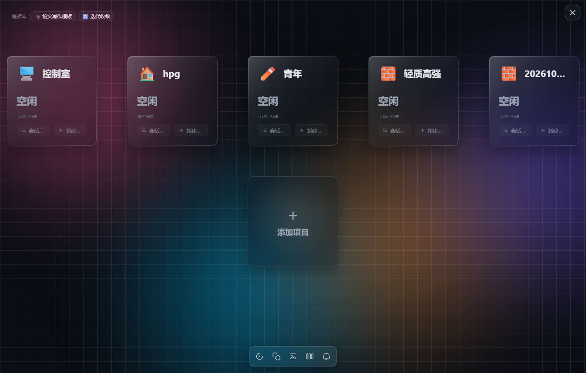
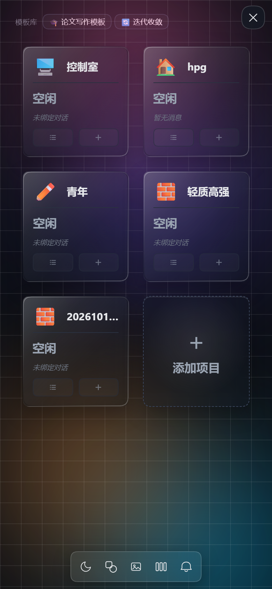
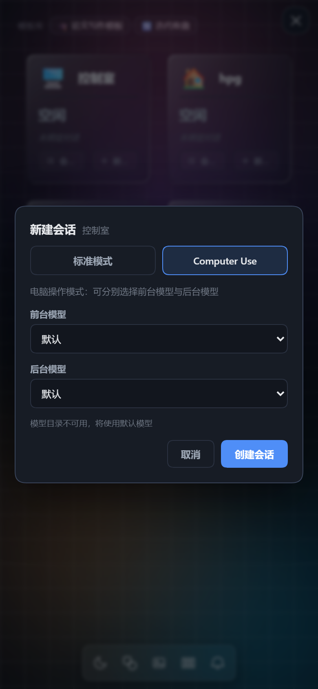
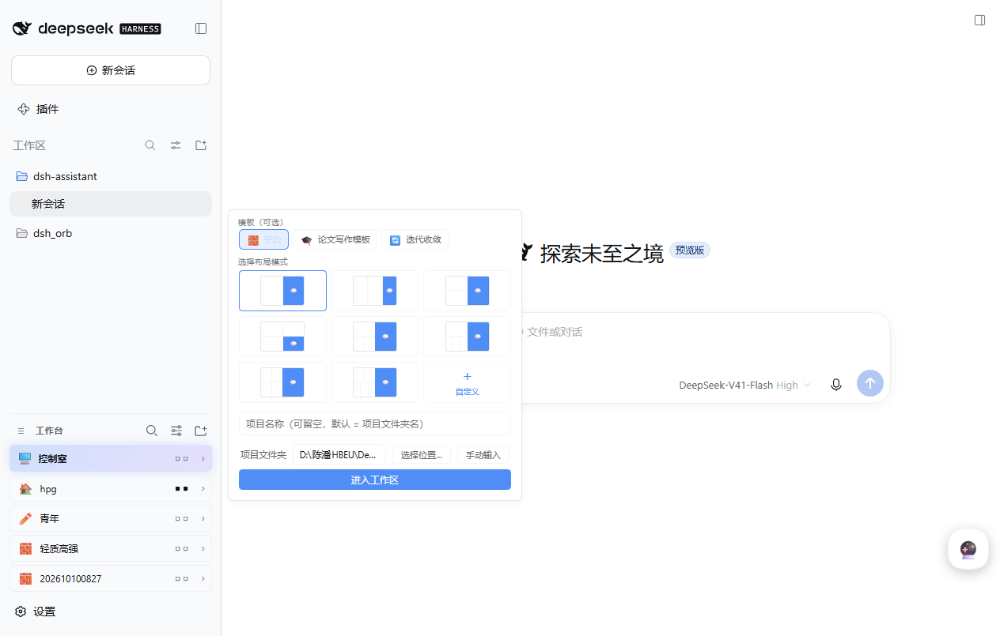

# dsh-assistant

DeepSeek Harness 一体化助手插件：**悬浮球 → 控制室**，外加**手机扫码远程访问**与**托管模式**。

它把三个既有插件的能力装进同一个包，不改动原插件代码：

- **工作台（dsh-worktable，MIT）**：控制室、项目 / 会话、分栏工作区、模板流程；
- **手机访问（dsh-pocket，GPL-2.0）**：局域网/公网代理、二维码、SSH 固定隧道、移动端适配、语音输入；
- **托管（dsh-tuoguan，MIT）**：提问 / 审批按默认项自动应答，状态存宿主、手机与电脑同步。

> 本包整体按 **GPL-2.0** 发布（因为内含 dsh-pocket 的 GPL 代码）。原插件的 LICENSE 与版权归各自作者。

## 界面

| 控制室（电脑） | 控制室（手机） |
|---|---|
|  |  |

| 新建会话（默认上次使用的模型） | 添加项目（模板 / 布局 / 文件夹） |
|---|---|
|  |  |

## 主要功能

### 悬浮球 → 全屏控制室（手机 / 电脑一致）

- **桌面端两颗悬浮球**：窗口内一颗页内球（可拖动、记住位置）+ 窗口外一颗原生 Electron 小窗（始终置顶、可拖到 DSH 窗口之外）；两颗都打开控制室，头像与「启用悬浮球」开关共用。网页 / CLI / 手机环境只有页内球。窗口外那颗是**真依赖**：`src/desktop-ball.ts` 会依次找 `~/.dsh/dsh-orb/electron-runtime/electron.exe`、`~/.dsh/dsh-assistant/electron/electron.exe`、`$DSH_ASSISTANT_ELECTRON`，都找不到就退回页内球（本机实测：第一条路径存在，所以窗口外那颗在用）。dsh-orb 自己的球不再注册，只保留这一套入口。
- **页内球始终可见、就是控制室的开关**：控制室打开期间它不消失，浮在控制室之上；点一下打开、再点一下关闭（电脑与手机一致）。窗口外那颗原生球仍只负责打开。
- 控制室侧栏不再出现「工作台」区块，唯一入口是悬浮球。
- 项目卡片按屏幕宽度自动排列；**列数是设备本地偏好**：电脑与手机分开保存、互不同步（dock 可手动 1–5 列）。
- 卡片状态色：**绿 = 进行中、黄 = 等待决策、红 = 异常终止**（点开项目确认后复位）、蓝 = 已完成。
- 卡片中间实时显示最新一条进度（如「运行命令 · 搜索标题栏高度」），每 1.2 秒从会话 history 刷一次（`src/client/index.tsx` 的活动扫描）。
- 每张卡片两个醒目的新建按钮：**「＋ 新建 / 对话」** 与 **「＋ 新建 / 电脑操作」**，分别新建普通对话 / 电脑操作会话；模型默认选中上次使用的模型（电脑操作另可选后台模型），不再出现「默认」空选项。
- 卡片「会话列表」：项目文件夹下全部会话（含模板步骤子目录），排序与「点卡片进入哪条会话」共用同一套判定（置顶 → 等你回答 → 正在跑 → 其余按最近更新），支持置顶 / 重命名 / 分叉 / 归档 / 恢复。
- **点卡片进入项目切到哪条会话**：先切进「进行中」的那条（等你回答优先于正在跑，多条同时在跑取最近有活动的那条；当前会话本就在这档里则保持不变），没有进行中的才按模板最新步骤 / 最近更新兜底。列表第一行与点卡片进入的那条一致。
- **卡片中间那块实时进度跟人走**：关联会话按活跃度排序（待决策 > 正在跑 > 异常 > 空闲，同档取最近更新），卡片进度按这个优先级依次取，**点卡片会进入的那条（含子代理）永远排第一**——显示的是第一条拿得到内容的会话的最新消息（实时事件 → 宿主日志行 → 最近一条消息），一条都拿不到才显示「正在执行…」。不会再把低优先级旧会话的成品消息当成实时进度（`progressOrderOf()`，与进入判定同源，`scripts/test-session-rank.mjs` 盯着这条）。
- 底部 dock「项目管理」：隐藏 / 恢复 / 删除项目（只删控制室条目，不动文件夹与会话）。
- 底部 dock「眼睛」按钮：一键隐藏未工作的项目卡片——只留进行中 / 等待决策 / 异常终止，再点恢复全部；开启时按钮高亮并显示卡片数量角标。

### 临时卡片「正在运行」

不在任何已创建项目文件夹里运行的会话（例如随手在桌面、下载目录或 DSH 默认工作目录里开的对话），
以前在控制室完全看不到。现在会自动收进一张临时卡片：

- **运行中 / 等你决策时**：卡片常驻，状态灯、实时进度、运行时长、子代理数、会话列表、＋新建会话都与其他项目卡片一致。
- **结束后**：该会话**一直保留**在卡片上，直到你手动点「会话列表 → 收工」；不按时间自动消失。
  点开某条已结束会话只是进入查看，不会把它移出卡片。
- **收工后**：只把这一轮已结束的会话从卡片移除；会话本身、磁盘日志、侧栏入口一律不动，随时可以继续对话。
- 收工只对「这一轮已结束」生效；同一会话下一轮再跑完时会重新出现。
- 卡片上的「＋ 新建 / 对话」与「＋ 新建 / 电脑操作」会在最近一条游离会话的目录里新建会话（继续收纳进这张卡片），
  不会把新会话绑定到任何真实项目，因此不会「藏」进项目卡片而看不见。

### Computer Use 坐标（原 dsh-orb 设置）

- 设置 →「个人助手」→ Computer Use 新增**「使用千分比坐标（0–1000）」**开关。
- 打开：模型按截图的 0–1000 比例给点击位置；关闭：按截图原始像素给位置。**GUI 点击经常偏就关掉它**。
- 坐标方式在会话创建时固定：切换后请新建一个「＋ 新建 / 电脑操作」会话；已打开的会话保持原样。

### 项目 / 会话模型

- 项目 = 文件夹 + 布局 + 绑定会话；项目文件夹下的所有会话自动归入该项目。
- **跨端同步**：项目、文件夹、绑定、模板进度与控制室视图存宿主（`/api/assistant/state`），手机与电脑第一次打开就一致；之后本机改动去抖 800ms 推给宿主，另一端每 3 秒轮询一次，实际约 4 秒内到对端。
- 添加项目保留模板库（空白 / 论文写作 / 迭代收敛）+ 布局 + 文件夹；不选时按时间 `YYYYMMDDHHmm` 自动新建。
- **「添加项目」不跳出控制室**：弹窗浮在控制室之上；手机端「选择位置」打开的是**电脑文件夹浏览器**（不再触发电脑端系统对话框）。
- **项目 × 对话联动（v0.2.10 修复）**：项目开着时，切到**项目之外**的会话会自动收起项目、回到普通会话布局。判定按「项目 = 文件夹」：模板项目里在各步会话之间来回切**不算离开**（它们都在项目文件夹下），私人助手（`~/.dsh/assistant`）则一定算离开。
- **当前会话识别适配 DSH 0.2（v0.2.10）**：0.2 起「当前会话」落在 `uiWorkspace.selection` 快照里，`sessions.list` 快照不再有 `current` 字段；插件按 `selection` → `sessions.current` → 旧 `list.current` → `localStorage dsh.sessions.current` 依次兜底，并新增订阅 `uiWorkspace.selection`。此前恒读到空串，联动、会话列表「当前」高亮、关项目回切 prev 全部失效。

### 私人助手（v0.2.10）

不用开项目卡片，直接找「会记得你做过什么」的助手。

- **控制室里是一张普通卡片**：图标 🤖、名称「私人助手」、默认排第一。状态灯（绿/黄/红/蓝）、中间实时进度、运行时长、子代理数、「会话列表」、「＋新建 / 对话」「＋新建 / 电脑操作」、重命名、换图标、隐藏、拖拽排序——与其他项目卡完全同一套逻辑，不是另写的卡片类型。
- **助手会话不再混进「正在运行」临时卡片**：助手目录被认作项目文件夹后，该目录下的会话归这张卡；删卡后写 `removed` 墓碑，不再自动重建（用户删掉就是明确不要）。
- **建卡时机**：首次同步（宿主状态覆盖本地）之后才建，且按 `layouts/removed` 变化重试最多 6 次——避免「建好又被采纳覆盖吃掉」。
- **入口不止三个**：轻点悬浮球仍是控制室（行为没改）；**长按悬浮球 600ms** 进助手；电脑上 **Ctrl+Alt+A** 全局热键；控制室顶栏右侧的「🤖 私人助手」按钮；卡片本体的「会话列表」；页面地址 `?assistant=chat` / `#assistant`；宿主路由 `POST /api/assistant/open-assistant`（外部唤起）。单击球永远只开控制室。
- **助手住在固定目录** `~/.dsh/assistant/`：`AGENTS.md`（人设 + 「什么时候直接做、什么时候建卡」+ 记忆与归档规矩，只在缺失时写入，不覆盖手改）、`journal/YYYY-MM-DD.md`（收工日志）、`notes/`（长期档案）、`outputs/`（杂物间）、`archive/`（搬走的老资料）。
- **家目录不会越用越臃肿**：会话日志根本不在这个目录（DSH 存在 `~/.dsh/sessions/<目录编码>/`），这里只有记忆资产 + 临时产物。每 6 小时（以及 `POST /api/assistant/tidy`）自动收一次：`outputs/` 里超过 **14 天**的文件直接删；`journal/` 满 **90 天**、或文件数超过 180 份的，搬进 `archive/journal/<年份>/`；`notes/` 总量超过 **8MB** 的搬进 `archive/notes/`；`archive/` 只搬不删（软上限 32MB 时面板上报告到顶了）。数量与是否到上限都显示在记忆面板里。
- **记忆面板**：设置 →「个人助手」→「🧠 它记下了什么」。逐条看 / 复制 / 删（先备份，`restartRequired` 明说）、整侧清空（要连点两次 + `DELETE-ALL`）、导出 `.md`；助手目录各区的文件数与体积、上限与「已到上限」都在这页。热记忆真值 `~/.mnemon/runtime/memories.json` 由插件直接改（写入前先备份成 `*.dsh-assistant-backup-<时间戳>`），改完要重启 DSH Desktop。
- **首启引导**：第一次用这个插件会弹一次三屏引导（悬浮球是干什么的 / 单击 vs 长按 / 记忆在哪看怎么删），看完或后一跳就不再自动弹；设置页里「重新看一遍首启引导」可重开，文案在 zh / en 词典（`src/client/firstRunGuide.ts`）。
- **目录边界**：内容窗与终端都走 allowlist（`src/path-guard.ts`）。默认允许根 = 助手目录 + 它的父目录、DSH 数据根、平台 Desktop、默认项目父目录、`skillRoot`、临时目录、插件仓库 cwd、用户主目录，加上配置里的 `allowedRoots`；越界一律 403 `outside-allowlist` 并带解析后的绝对路径。终端只带白名单环境变量（`termEnvAllow` 可追加），不再整包 `process.env`。要全盘放行只在配置里写 `"allowAllLocalPaths": true`。
- **每次打开都是新会话**：上下文不随使用无限增长；「记得你」靠 USER/MEMORY/AGENTS/journal 这套记忆，不靠一条会话的上下文。同目录同模式的空白会话会被复用，不堆空白；历史会话都在卡片「会话列表」里可回看。
- **助手永远是单一会话布局（v0.2.10）**：打开助手前会先收起当前项目分栏工作区。此前在论文写作模板项目里长按悬浮球进助手，流程窗格 + 对话列一直挂着，看起来像「项目还在左右分屏」。
- **默认 computer-use 模式**（能看屏幕、点界面）；dsh-orb 被停用时自动退回标准模式。
- **默认沿用上一次的模型**：先读上一条助手会话实际在用的模型（用户可能在对话页换过），没有记录时退回本机上次选过的模型。
- **记忆闭环**：热记忆（`USER.md` / `MEMORY.md` 每轮注入）+ 人设里的收工蒸馏（写 journal、更新记忆、纠正即覆盖）+ `mnemon` 检索；记忆真值在 `~/.mnemon/runtime/`。
- **一键导出诊断包（脱敏）**：设置 →「个人助手」页底的「🧰 导出诊断包（脱敏）」按钮（`src/assistant-diagnostics.ts`）。包里放的是：插件/清单/Node 版本、`~/.dsh/dsh-assistant-focus.log` 尾部、`<profile>/dsh-assistant-ball/helper.log` 尾部、`$DSH_HOME/dsh-pocket/diagnostic.jsonl` 的摘要（只留计数与最近几条的关键字段，payload 不倒）、状态 json 的概要（revision / 项数，不带内容）、助手目录用量、目录 allowlist 的根列表。写盘前一律过脱敏：已知绝对根（主目录 / DSH 数据根 / profile / 助手目录 / Desktop / 临时目录 / `skillRoot` / `allowedRoots`）换成 `<HOME>` `<DSH>` `<PROFILE>` `<ROOT>` 之类标记，残留的 `X:\...`、`/Users/...`、`/home/...` 换成 `<PATH>`，`pin:` / `token=` / `password:` / `Bearer …` / 32 位以上十六进制串、以及 **JSON 字符串内部** 的 6–8 位数字串换成 `«已脱敏»`（数字字段本身不动，不然包会 invalid）。`dsh-pocket/settings.json` 整份都不进包（PIN / 隧道 Token / cloudflared 路径都在那里），包里还有一行 `notCollected` 明确写着「哪些东西故意不给」。落盘位置：`~/.dsh/assistant/outputs/diagnostics-<时间戳>.json`（尽力 0o600），按钮旁边显示真实路径、体积与「脱敏替换 N 处」，另有一份浏览器下载。
- **助手档案导出 / 导入**：页底的「📦 导出助手档案」与「📥 导入助手档案」（`src/assistant-archive.ts`）。导出是**单一 JSON 清单**（仓库里没有压缩库，也不为此新引一个 devDependency）：AGENTS.md、`journal/`、`notes/`、`archive/`、`config.json`、`USER.md` / `MEMORY.md` / `memories.json`、跨端状态 json；每项带相对路径、字节数与 SHA-256，整包带 `checksum`、文件数与总体积。导出的文件落 `~/.dsh/assistant/exports/archive-<时间戳>.json`（`exports/` 不在 `outputs/` 的 14 天自动清范围里，不会被悄悄删掉）。导入按 `?` 规则走：先校验 `checksum`（对不上整包拒绝，一个文件都不落）、把现有 AGENTS.md / journal / notes 现状备份到 `archive/import-backup-<时间戳>/`、按文件夹判重（内容 hash 一样 → 跳过）、内容不一样 →【不覆盖】，另存成 `<原名>.imported-<时间戳>.<后缀>`；`state` 区一律拒收（删除墓碑不写回，报告里 `tombstonesIgnored` 说明数量）；包里的相对路径不许跳出该区目录（`../` 与绝对路径都拒）。本机没有的预设 / 模板 id 不静默：报告 `missingPresets` 列表。UI 上直接打印「导入了什么、跳过了什么、冲突另存成哪、备份目录在哪、墓碑没写回」。`dryRun:true` 只报告不落盘。
- 宿主路由：`GET /api/assistant/home`（含 usage/limits/文件清单）、`GET /api/assistant/memory`、`POST /api/assistant/memory-entry-delete`、`POST /api/assistant/memory-clear`（要 `confirm:'DELETE-ALL'`）、`GET|POST /api/assistant/tidy`（收 + 归档）、`GET /api/assistant/config`、`GET|POST /api/assistant/state`、`GET|POST /api/assistant/open-assistant`（热键/外部唤起，带 intent 复用悬浮球长轮询）、`GET /api/assistant/diagnostics` + `POST /api/assistant/diagnostics/export`（一键诊断包，见下）、`GET /api/assistant/archive` + `POST /api/assistant/archive/export` + `POST /api/assistant/archive/import`（助手档案导出/导入，见下）。
- 直达：`…/?assistant=chat` 或 `…/#assistant`。
- **升级后需重启一次 DSH Desktop**：宿主新增的路由、全局热键与桌面球长按都要宿主重启才生效（只刷新页面只能拿到新客户端）。v0.2.10 改的全是客户端，刷新页面即可生效；**只要动过宿主侧代码（路由 / 热键 / 服务），就必须重启 DSH Desktop**。

### 手机访问（原 dsh-pocket 全套）

- 设置 →「个人助手」→ 手机访问：局域网 / 公网二维码、访问密码、SSH 固定隧道、移动端布局。
- 手机访问使用独立 Cordis 生命周期；个人助手其他模块热重载不会重启代理 / SSH，登录会话密钥持久化，更新与重启不再强制手机重登。
- 手机默认只精简桌面原生能力、埋点与开发期 HMR；系统设置、Skill、自动化任务、记忆系统等用户功能完整保留。需要完整插件树时仍可在地址加 `?dsh-full-plugins=1`。
- 独立的「手机访问」设置页签已删除，内容收进「个人助手」。
- 左侧菜单 = 官方侧栏那一列改成的抽屉：首屏 700 毫秒内先补做「图标 rail → 完整列表」的官方升级（不再挂在第一次点汉堡上），按下汉堡即把那一列提到独立合成层（`will-change` 520 毫秒内必撤，久留会让它成为宿主设置面板 portal 的包含块）；抽屉右上角那颗「打开侧边栏」在手机布局里收掉，官方键盘快捷键照旧。开合耗时实测进诊断流水（`drawer-open` 阶段带 `ms` / `up`）。
- 输入让路纪律（`src/client/compositionGate.ts` + `scripts/test-composition-gate.mjs`）：用户在输入框里打字（含手机语音输入法实时转写）或抽屉开合的窗口内，插件自己的整页扫描、DOM 补丁、状态轮询一律先让路（批次不丢，到点补跑），插件补丁一律不碰输入框那一棵树。第三方套件 dsh-web-ui 的三个兼容观察者改成有界确认（`featurePresence.mjs`）：本机没有 `[data-aionui-*]` 那两列就不再挂整页观察者。手机布局另有一条只读语音探针（`voice-compose` 诊断记录：说了几段 / 一共进去多少字 / 有几段没等到 `compositionend` 就被中止），配合「一键导出诊断包」看断在哪一类。要定位「谁在那一刻动了输入框」，组合期间还会挂一个只读取证账本（`composerLedger.ts` + `scripts/test-composer-ledger.mjs`：最多 8 条变更签名，加 `EDITOR-TOUCHED` / `EDITOR-SWAPPED` / `PHASE-FLIP` 三个判定），可疑中止会把它压成一行写进同一条记录。

### 托管（原 dsh-tuoguan）

- composer 右侧「托管」开关；开启后提问 / 审批自动按默认项应答。
- 状态存宿主，手机与电脑同步；默认开启（只记录被显式关闭的会话）。

## 安装

```powershell
cd D:\dsh-assistant
npm run build

# 装进 desktop profile：建 junction，并把 dsh-pocket / dsh-worktable / dsh-tuoguan
# 从 bundles 换成 dsh-assistant（自动备份 package.json，可回退）
node scripts\install-assistant.mjs desktop

# 重启 DSH Desktop
```

回退：把 `<用户目录>\.dsh\profiles\desktop\package.json.bak-assistant-<时间戳>` 复制回 `package.json`，重启即可。

## 卸载

```powershell
# 先看计划，什么都不动
node scripts\uninstall-assistant.mjs --dry-run

# 真卸载（只解除安装，不删任何本机数据）：摘 junction + 从备份还原 profile 的 package.json
node scripts\uninstall-assistant.mjs            # 默认 profile：desktop
node scripts\uninstall-assistant.mjs web        # 换 profile

# 连数据一起清（删前一律先挪进 ~/.dsh/uninstall-backup-<时间戳>/，可翻回来）
node scripts\uninstall-assistant.mjs --purge
```

- 脚本不删仓库目录本身，也不删会话（`~/.dsh/sessions`）或宿主记忆真值（`~/.mnemon`）。
- `--purge` 覆盖：`<profile>/dsh-assistant-ball/`、`~/.dsh/assistant/`（含 `config.json`、`AGENTS.md`、`journal/`、`notes/`、`outputs/`、`archive/`）、`<profile>/dsh-assistant-state.json`、`~/.dsh/dsh-tuoguan-state.json`、`~/.dsh/dsh-assistant-focus.log`、兼容旧位置的 `~/.dsh/dsh-assistant-config.json`。
- 浏览器侧的数据脚本碰不到（它在宿主页面里），脚本会打印名单与可粘贴的 DevTools 片段：IndexedDB `dsh-worktable`；localStorage 前缀 `dsh.assistant.*`、`dsh.worktable.*`、`dsh-assistant.*`、`dsh-tuoguan.*`、`dsh-pocket.*`。**`dsh.sessions.current` 是宿主的，不清。**
- 旧名字（`dsh-worktable` / `dsh.worktable.*` / CSS `dsh-wt_*`）留在数据键里是**故意**的：改了就会丢本机照片库与卡片视图。
- 卸载完必须重启 DSH Desktop 才算生效。回归测试：`node scripts\test-uninstall-plan.mjs`。

## 本机个人化配置（不入库）

仓库里没有任何「只有本机才成立」的常量（个人目录、人名词表、技能根）。这些值放在本地配置文件：

```
~/.dsh/assistant/config.json          ← 首选（助手家目录里）
<DSH_HOME>/dsh-assistant-config.json  ← 兼容旧位置
$DSH_ASSISTANT_CONFIG                 ← 显式覆盖（换机 / 测试用）
```

字段（都可选）：

```json
{
  "newProjectParent": "D:\\我的默认项目父目录",
  "skillRoot": "C:\\Users\\me\\.dsh\\skills",
  "asrTerms": [{ "pattern": "示例昵称|示例昵称写错", "replace": "示例规范名" }],
  "allowedRoots": ["D:\\我的项目盘"],
  "persona": { "title": "本机人设", "lines": ["我是谁，做什么"] },
  "termEnvAllow": ["PATH", "HOME"]
}
```

- `newProjectParent`：新建项目未选文件夹时的默认父目录；未配置时按「平台 Desktop → 助手目录下的 `projects/`」回落（UI 里显示为「默认（本机配置）」，点「选择位置…」可临时改）。
- `skillRoot`：`templates.ts` / `verifyLoop.ts` 里技能文件路径的前缀；未配置时用 `<DSH_HOME>/skills`。
- `asrTerms`：语音转写的个人化词表（人名 / 校院名 / 店名）。正则源串写进 JSON，`flags` 缺省为 `g`；坏正则只跳过该条。
- `persona`：写进 `AGENTS.md` 的托管段落（只在这份 AGENTS.md 是本插件生成的通用模板时插入；你自己写的 AGENTS.md 永远不动）。
- 改完配置文件：页面刷新一次（宿主已下发，客户端缓存刷新）；纯 client 改动不需要重启 DSH。

## 开发

```powershell
npm run build      # lib/index.js（宿主）+ lib/pocket.js（手机访问）+ lib/client.js（客户端）+ computer-use 三个包
npm run check      # node --check 三个产物（语法级）
npm test           # 30 个 scripts/test-*.mjs 串接（无测试框架，失败即退出码 1）
npm run typecheck  # tsc --noEmit（见下：目前【过不了】，见「质量门」）
npm run lint       # scripts/lint-standards.mjs（不靠 eslint：查个人化残留 / 退役仓库名 / 版本源一致性）
```

- 客户端 bundle 走 `window.__ModuleLoader__.load({ id: 'dsh-assistant', factory })` 握手，react / `@deepseek-ai/*` 保持 external。
- 改完插件在本仓库根目录跑 `npm run build`；本机安装是 junction，所以一次 build 就生效。纯客户端改动刷新页面即可；**宿主改动（路由 / 热键 / 服务）必须重启 DSH Desktop**。
- 发版前 `build.mjs` 会硬校验两处版本号一致（`package.json` 与 `dsh.plugin.json`），并强制 `CHANGELOG.md` 里有当前版本那一节（控制室的「更新公告」正文由它生成）。

## 质量门（诚实说明）

- `npm run check` 与 `npm test` 本机实测：30 项测试全 PASS、退出码 0。`npm run lint` 也是退出码 0（`build` / `check` / `test` / `lint` 四连发本机刚跑过一轮）。
- **`npm run typecheck` 本机实测【过不了】：282 个 TS 错误**（几乎全是 `TS2591: Cannot find name 'node:fs' / 'process' / 'Buffer'` —— 没有 `@types/node`；另有 `src/assistant-home.ts` 两处 `timer.unref()` 类型缺口）。原因两类：① 宿主包 `@deepseek-ai/*` 在本仓库没有 `.d.ts`（运行时是 external）；② 没装 `@types/node`。现在仓库有 `tsconfig.json`（只 `include: src/**`，排除 `src/pocket-host`、`src/cu-shims`），编译器是本机借的 harness 里那份 TypeScript（`scripts/typecheck.mjs` 会先找仓库自己的 `node_modules/typescript`，再看 `$DSH_ASSISTANT_TSC`，最后才是 harness 那份；**找不到编译器就退出 2 并说明「跑不起来」，跑不起来也绝不打印「通过」**）。仓库里没有 typescript devDependency，所以 CI 里这条只能靠 `continue-on-error` 不阻塞。要补的账：`npm i -D typescript @types/node` + 宿主类型，然后才能让 typecheck 变绿。这条**不**塞进 `npm test`。
- `npm run lint` 不引 eslint（本机离线装不上）：`scripts/lint-standards.mjs` 做它做得动的——个人化标识与退役仓库名不得复现、两处版本号一致、运行时自名一致、宿主日志不再自称 `[dsh-worktable]`、`.mjs` 脚本里不许出现 TS 注解。客户端那些 `console.warn('[dsh-worktable] …')` 前缀、`dsh.worktable.*.v1` 存储键、IndexedDB `dsh-worktable`、CSS `dsh-wt_*`、槽位 id 都是**故意留着的旧名**（改了会丢本机照片库与卡片视图），所以 lint 只查宿主侧。
- `.github/workflows/ci.yml`：矩阵 ubuntu-latest + windows-latest（Node 22），步骤 `npm install` → `npm run build` → `npm run check` → `npm test` → `npm run lint`，typecheck 挂 `continue-on-error`。**这份 workflow 本机没有跑过（不 commit / 不 push），GitHub 上会不会绿我没验过**；已知风险是仓库没有 `package-lock.json`，所以用的是 `npm install`。

## 目录

- `src/assistant.ts`：宿主入口（工作台 + 托管 + 跨端状态 + 助手目录 + 桌面球；手机访问已拆为独立入口）
- `src/index.ts`：原工作台宿主（`/api/worktable/*`，已过目录 allowlist）
- `src/path-guard.ts`：目录 allowlist（`check()` 越界拒绝）+ 终端最小环境变量
- `src/assistant-config.ts`：本机个人化配置读取（`~/.dsh/assistant/config.json` 等三个候选 + `DSH_ASSISTANT_CONFIG`）与 `/api/assistant/config`
- `src/assistant-home.ts`：助手家目录（AGENTS.md 托管段落、journal/notes/outputs/archive、归档与容量上限、`/api/assistant/{home,tidy}`）
- `src/assistant-diagnostics.ts`：一键导出诊断包（P1-A）——收集 + 脱敏（`redactText`）+ 落 `outputs/`，路由 `/api/assistant/diagnostics{,/export}`
- `src/assistant-archive.ts`：助手档案导出 / 导入（P1-B）——单一 JSON 清单、SHA-256 与体积、导入前备份、判重、不覆盖、墓碑不写回
- `src/assistant-memory.ts`：宿主热记忆读写（`~/.mnemon/runtime/memories.json` + USER.md/MEMORY.md 投影，写入必带备份）
- `src/pocket.ts` + `lib/pocket.js`：手机访问独立 Cordis 入口（`dsh-assistant/pocket`），独立构建、独立生命周期；首启默认「局域网关闭 + 局域网要密码」，已有安装不动
- `src/web-routes.ts`：webServer 路由集中登记与注销，防热重载重复注册导致 apply 中途失败
- `src/pocket-host/`：原 dsh-pocket 宿主（代理 / 隧道 / RPC / `settings.mjs`）；含 `runtime.mjs`（跨 HMR 复用运行实例）、`mobile-boot.mjs`（手机端模块精简与批次权重）、`mobile-batch.mjs`（本地合包 + gzip/Brotli）
- `src/tuoguan-host.ts`：原 dsh-tuoguan 宿主（`dsh-tuoguan-state.json`）
- `src/assistant-store.ts`：项目 / 视图跨端同步（`<profile>/dsh-assistant-state.json`）
- `src/desktop-ball.ts`：Electron 原生桌面悬浮球（找 Electron 运行时，找不到退回页内球）
- `src/client/index.tsx`：工作台客户端（控制室 / 分栏 / 模板流程）
- `src/client/assistant-config.ts`：客户端侧的宿主下发配置缓存
- `src/client/assistant-memory-panel.tsx`：设置里的「🧠 它记下了什么」面板
- `src/client/firstRunGuide.ts`：三屏首启引导（状态 + zh/en 文案 + DOM 覆盖层）
- `src/client/updateCheck.ts`：**唯一的更新源**（版本号、升级命令、检查缓存都在这一处）；`src/client/changelog.ts` 的公告正文由 `build.mjs` 从 `CHANGELOG.md` 注入
- `src/client/newProjectDefault.ts` / `src/client/projectExit.ts` / `src/client/clipboard.ts` / `src/client/toast.ts`：默认项目目录、离开项目判定、剪贴板写入、右下角小提示
- `src/client/control-room.tsx`：悬浮球打开的全屏控制室；`src/client/assistant-settings.tsx`：设置「个人助手」；`src/client/tuoguan.tsx`：托管开关与自动应答
- `src/client/pocket/`：原 dsh-pocket 客户端
- `CHANGELOG.md`：唯一的公告源（`## [<版本>]` 那一节随包发到控制室）
- `scripts/install-assistant.mjs` / `scripts/uninstall-assistant.mjs` / `scripts/lint-standards.mjs` / `scripts/test-*.mjs`

## 致谢

- [dsh-worktable](https://github.com/xiaoshumiao00-lang/dsh-worktable)（MIT）
- [dsh-pocket](https://github.com/shaobeichen/dsh-pocket)（GPL-2.0）
- [dsh-tuoguan](https://github.com/xiaoshumiao00-lang/dsh-tuoguan)（MIT）
